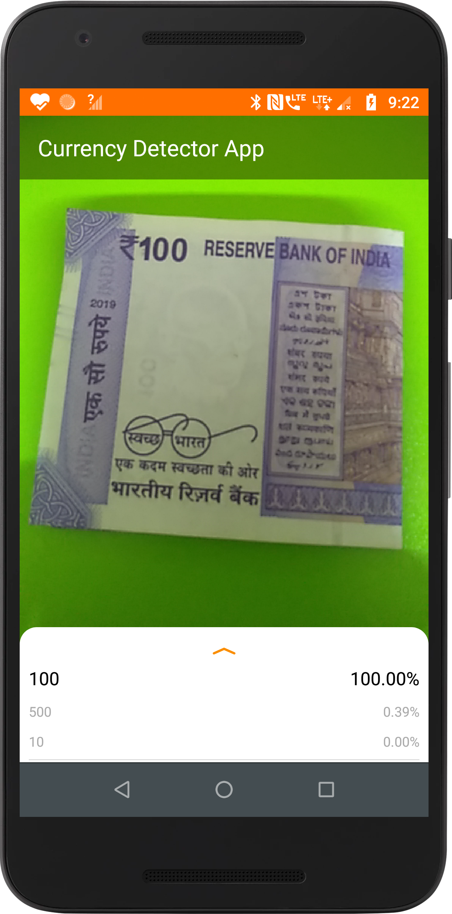

# Currency Detection App for the Visually Impaired

An Android app that uses the phone's back camera to recognise currency notes in real time with **TensorFlow Lite** image classification, so visually impaired users can identify notes.

- **Model:** ResNet50 trained with Google Teachable Machine (batch size 16, 100 epochs), exported to TensorFlow Lite.
- **Inference:** TensorFlow Lite Java API, on CPU, GPU or NNAPI, with a configurable thread count.
- Based on the [TensorFlow Lite image classification example](https://github.com/tensorflow/examples/tree/master/lite/examples/image_classification/android). See [`EXPLORE_THE_CODE.md`](EXPLORE_THE_CODE.md) for a walkthrough of the code.

| | |
|---|---|
|  | .png) |

> ⚠️ **The Android source code (`app/` module) is not in this repository.** `app` is currently an empty file, so the project cannot be built yet. To make it buildable, upload the `app/` folder from your Android Studio project (it contains `src/`, `build.gradle` and `assets/` with the `.tflite` model and `labels.txt`), replacing the empty `app` file.

## How to run (step by step, once `app/` is added)

**1. Install Android Studio** (latest version) from https://developer.android.com/studio

**2. Download the project**

```bash
git clone https://github.com/amitmohanty022/Currency-Detection-App-for-Visually-Impaired.git
```

**3. Open it**

In Android Studio, choose **File → Open** and select the `Currency-Detection-App-for-Visually-Impaired` folder. Android Studio creates `local.properties` with your SDK path automatically.

**4. Let Gradle sync**

If Android Studio offers to upgrade the Android Gradle Plugin, accept it. Install any SDK it asks for (minimum SDK 23).

**5. Prepare your phone**

- Turn on **Developer options** (tap *Build number* 7 times in *Settings → About phone*).
- Turn on **USB debugging**, connect the phone with a USB cable, and accept the prompt on the phone.

**6. Run**

Click **Run ▶** and select your phone. Open the app, allow camera access, and point the camera at a currency note.

## Updates (2026)
- `jcenter()` (shut down) replaced with `mavenCentral()` in `build.gradle`.
- `local.properties` (machine-specific SDK path) is no longer tracked.
